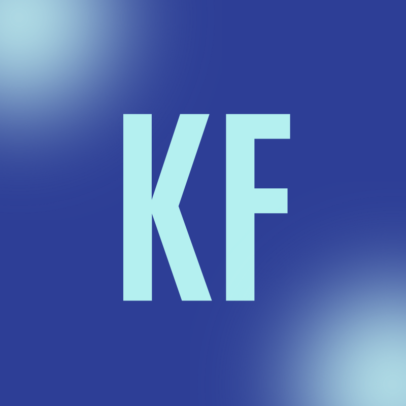
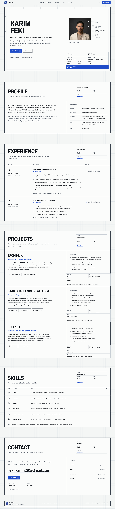
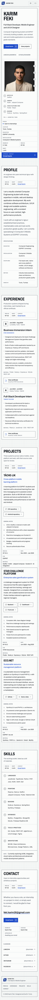

# Karim Feki — Portfolio

<p align="center">
  <a href="https://karimfeki.is-a.dev">
    
  </a>
</p>

<h3 align="center">Full-Stack Developer · Mobile Engineer · UI/UX Designer</h3>

<p align="center">
  A production-focused portfolio for Karim Feki, a Computer Engineering student at ESPRIT University in Tunis.
</p>

<p align="center">
  <a href="https://karimfeki.is-a.dev">Live portfolio</a>
  ·
  <a href="mailto:feki.karim28@gmail.com">Email Karim</a>
  ·
  <a href="https://github.com/fekikarim">GitHub</a>
  ·
  <a href="https://www.linkedin.com/in/karimfeki/">LinkedIn</a>
</p>

<p align="center">
  
  
  
  
  
</p>

## Overview

This repository contains the complete source for [karimfeki.is-a.dev](https://karimfeki.is-a.dev), a single-page portfolio designed to help recruiters and engineering leads quickly evaluate shipped work, technical range, and verifiable experience.

The interface is intentionally structured as a signed engineering drawing set: framed sheets, title blocks, revision tables, technical notes, and a restrained drafting-blue accent. The same system adapts from a full desktop canvas to a compact, readable mobile flow.

## Current preview

The following captures show the complete page from top to bottom at representative desktop and mobile widths. They are stored in the repository so the README remains stable and does not depend on an external image host.

### Desktop — full-page view

<p align="center">
  <a href="public/demo/desktop.png">
    
  </a>
</p>

### Mobile — full-page view

<p align="center">
  <a href="public/demo/mobile.png">
    
  </a>
</p>

> Open either image in a new tab for the full-resolution capture. The desktop preview is 1440px wide and the mobile preview is 390px wide.

## What is included

- **Hero** — identity, role, portrait, location, education, and direct contact action.
- **Profile** — engineering focus, disciplines, education, and working preferences.
- **Experience** — internships at Tunisie Telecom, STAR Assurances, and STEG with certificate access.
- **Projects** — featured and earlier work with roles, teams, capabilities, technologies, and repository/live links.
- **Certifications** — NVIDIA, AWS Academy, and Hedera credentials with in-app document previews.
- **Skills** — languages, frontend, backend, databases, tooling, and architecture.
- **Contact** — email-first CTA and social profiles.
- **Theme system** — light drafting paper and dark blueprint modes with a shared layout language.
- **Responsive layout** — the same information architecture remains usable on phones, tablets, and desktop screens.
- **Accessible interactions** — semantic sections, keyboard focus states, reduced-motion support, and clear action labels.

## Technology

| Area | Tools |
| --- | --- |
| Application | React 18, React Router |
| Language | TypeScript |
| Build | Vite 5, SWC |
| Styling | Tailwind CSS, CSS variables, `tailwindcss-animate` |
| UI primitives | Radix UI, shadcn/ui patterns, `lucide-react` |
| Typography | Archivo Variable |
| Themes | `next-themes` |
| Validation and forms | React Hook Form, Zod |
| Testing | Vitest, Testing Library, jsdom |
| Quality | ESLint, TypeScript |

## Architecture

```text
src/
├── components/
│   ├── drawing/             # Sheet and document-viewer primitives
│   ├── layout/              # Header and footer
│   ├── sections/            # Hero, profile, experience, projects, etc.
│   └── ui/                  # Reusable Radix/shadcn-style components
├── hooks/                   # Responsive and scroll-reveal hooks
├── lib/
│   ├── documents.ts         # Certification and internship document records
│   ├── profile.ts           # Navigation and contact data
│   ├── projects.ts          # Project content and external links
│   └── utils.ts             # Shared helpers
├── pages/                   # Route-level page composition
├── App.tsx                  # Providers and application shell
├── App.css                  # Application-level styling
└── index.css                # Global tokens and theme styles
public/
├── assets/                  # Portrait, logo, and favicon
├── certifs/                 # Credential files and preview images
└── demo/                    # Full-page README screenshots
```

The main page composition lives in [`src/pages/Index.tsx`](src/pages/Index.tsx). Content is kept separate from presentation where possible, making updates to projects, links, certifications, and navigation safer and easier to review.

## Run locally

### Requirements

- Node.js LTS
- npm (the repository includes `package-lock.json`)

### Install dependencies

```bash
npm install
```

### Start the development server

```bash
npm run dev
```

Vite serves the app at `http://localhost:8080`.

## Available scripts

| Command | Purpose |
| --- | --- |
| `npm run dev` | Start the Vite development server |
| `npm run build` | Create the production bundle |
| `npm run build:dev` | Create a development-mode bundle |
| `npm run preview` | Serve the production bundle locally |
| `npm run lint` | Run ESLint across the project |
| `npm run test` | Run the Vitest suite once |
| `npm run test:watch` | Run Vitest in watch mode |

Before opening a pull request, run:

```bash
npm run lint
npm run test
npm run build
```

## Updating portfolio content

Most content changes do not require editing the page layout:

1. Update personal navigation and social links in [`src/lib/profile.ts`](src/lib/profile.ts).
2. Update projects, roles, technologies, and external links in [`src/lib/projects.ts`](src/lib/projects.ts).
3. Update certifications and internship documents in [`src/lib/documents.ts`](src/lib/documents.ts).
4. Put public media and documents in [`public/assets/`](public/assets/) or [`public/certifs/`](public/certifs/).
5. Replace the README captures in [`public/demo/`](public/demo/) when the visual design changes.

Keep external links on HTTPS and preserve the existing document paths so the certificate tests continue to validate every referenced file.

## Deployment

The app is a static Vite build and can be deployed to Netlify, Vercel, GitHub Pages, or any static host:

```bash
npm run build
```

Publish the generated `dist/` directory. The Vite configuration also injects a production Content Security Policy and disables source maps in production builds.

## Design direction

The visual language is documented in [`DESIGN.md`](DESIGN.md). Its core principles are:

- sheets instead of floating cards;
- square geometry and explicit frame rules;
- condensed technical lettering for headings and labels;
- one drafting-blue accent for actions and emphasis;
- linework and hierarchy instead of decorative shadows;
- visible content first, with motion used as a quiet plotting effect.

## Contact

- Website: [karimfeki.is-a.dev](https://karimfeki.is-a.dev)
- Email: [feki.karim28@gmail.com](mailto:feki.karim28@gmail.com)
- GitHub: [@fekikarim](https://github.com/fekikarim)
- LinkedIn: [@karimfeki](https://www.linkedin.com/in/karimfeki/)
- Instagram: [@karimfeki.co](https://www.instagram.com/karimfeki.co/)
- Facebook: [@KarimFeki.co](https://www.facebook.com/KarimFeki.co/)

## License

This project is released under the [MIT License](LICENSE).
